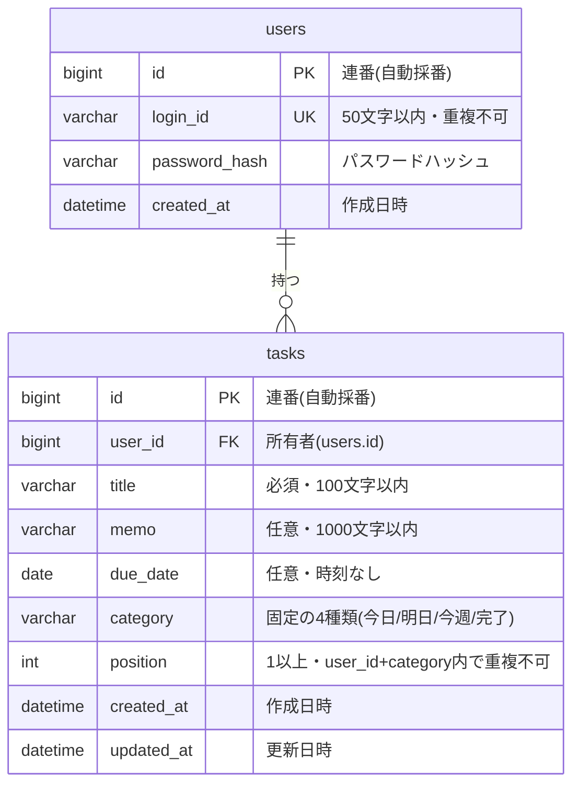

# DB 設計(データ設計・ER 図)

最終更新: 2026-11-24

- 設計の状態: **完了(承認済み)**
- 実装の状態(試行): backend/ に試行環境(Java 25 / Spring Boot 4.0.10 / Gradle 9.9.2 / PostgreSQL 17 / Docker Compose)を作成済み(2026-11-22 時点。ビルド、PostgreSQL の起動、テーブルと制約の作成、再起動後の維持、Spring Boot からの DB 接続は確認済み。Hibernate の `validate` の成功は、ユーザーが報告した起動ログと設定値にもとづく判断で、起動ログ全文は未確認。Repository 経由のデータの読み書き、`DEFERRABLE` の動作、起動テストは未検証。API、Controller、Service、認証、タスク登録機能は未実装)。frontend/ に初期環境(React / Vite / JavaScript / npm / CSS Modules)を作成済み(2026-11-21 時点。ビルドと開発サーバーの起動、ブラウザでの初期画面の表示は確認済み。タスク管理の機能、API 連携、認証は未実装)。画面モックは prototype/ にもある。これらは試行であり、技術の採用確定ではない

要件は [requirements.md](requirements.md)、画面は [screen-design.md](screen-design.md) を正とする。ラベルは同じ(【確定】=承認済み / 【提案】=承認待ち / 【未決定】=要検討)。

## 進め方

| 順 | 項目 | 状態 |
| --- | --- | --- |
| 1 | テーブル構成(users / tasks) | 確定(下記 1 章) |
| 2 | 並び順の持ち方 | 確定(下記 2 章) |
| 3 | 各項目の型・必須/任意・文字数 | 確定(下記 3 章) |
| 4 | ER 図(Mermaid)の確定 | 確定(下記 4 章) |

## 1. テーブル構成

- 【確定】データベースに「users」テーブルを作成し、アカウント情報を管理する
- 【確定】「tasks」テーブルは、所有者を示す「user_id」を持つ。各タスクは、user_id によって所有者と関連付ける
- 【確定】パスワードは、平文ではなく、安全なパスワードハッシュとして保存する
- 【確定】現時点では自分 1 人だけが利用するため、ユーザー登録画面は作らない。初期アカウントは、サーバー側で作成する
- 【確定】将来のマルチユーザー対応を妨げない構造にする
- 【確定】分類(今日・明日・今週・完了)は 4 つ固定のため、テーブルにはせず、tasks の項目として持つ想定
- 【未決定】ハッシュの方式(認証方式を決める段階で相談する)

## 2. 並び順の持ち方(確定)

- 【確定】タスクごとに、1, 2, 3, … という連番(position)を持つ
- 【確定】並び替えや、先頭への移動のたびに、影響するタスクの番号を振り直す
- 【確定】同じ分類の中で、番号が重ならないようにする(同じ user_id と category の中で、position は一意)
- 注: 振り直しの方法(1 回の通信でまとめて保存するか)は、API 設計の段階で整理する

## 3. 項目の定義(確定)

### users(アカウント)

| 項目 | 型 | 必須 | 内容・制約 |
| --- | --- | --- | --- |
| id | 数値の連番(自動採番) | 必須 | 主キー |
| login_id | 文字列(50 文字以内) | 必須 | ログイン用の ID。重複不可 |
| password_hash | 文字列 | 必須 | パスワードハッシュ(長さは、ハッシュの方式に合わせる) |
| created_at | 日時 | 必須 | 作成日時 |

### tasks(タスク)

| 項目 | 型 | 必須 | 内容・制約 |
| --- | --- | --- | --- |
| id | 数値の連番(自動採番) | 必須 | 主キー |
| user_id | 数値 | 必須 | users.id を指す(所有者) |
| title | 文字列(100 文字以内) | 必須 | タイトル |
| memo | 文字列(1,000 文字以内) | 任意 | メモ。空のときは、データなし |
| due_date | 日付(時刻なし) | 任意 | 期限日。空のときは、データなし |
| category | 文字列(固定の 4 種類の値のみ) | 必須 | 今日・明日・今週・完了に対応する固定の値 |
| position | 整数(1 以上) | 必須 | 同じ user_id・category の中で、重複不可 |
| created_at | 日時 | 必須 | 作成日時 |
| updated_at | 日時 | 必須 | 更新日時 |

- 【確定】タスクの削除は、物理削除(データそのものを消す)とする
- 【確定】上記の型・必須/任意・文字数・制約で確定する
- 【未決定】category の固定値の具体的な名前(英語表記など)、ハッシュの方式と、それに合わせた password_hash の長さ。いずれも、技術選定・認証方式の段階で決める

## 4. ER 図

補足(確定した制約):
- tasks の (user_id, category, position) は、重複不可
- 型の名前(bigint、varchar など)は、図を読みやすくするための仮の表記。実際の型は、データベースの選定後に決める

## 5. 承認結果と引き継ぎ事項

- 【確定】上記の ER 図を、データ設計の最終版として承認(2026-11-17)。users と tasks の 1 対多の関係、主キー・外部キーの定義、user_id・category・position による並び順の管理、将来のマルチユーザー対応を妨げない構造を確認済み
- 【確定】(user_id, category, position) の複合ユニーク制約は、実際の DB 構築時に、確実に設定する
- 【引き継ぎ】並び替え時の一時的な番号重複への対処(振り直しの手順)は、API 設計の段階で検討する
- 【引き継ぎ】category の固定値の具体的な名前、ハッシュの方式と password_hash の長さは、技術選定・認証方式の段階で決める

## 6. データの項目と入力ルール(旧 要件定義書 4.1.2)

- 【確定】タスクのデータ項目: タイトル、メモ、期限日(任意)、所属する分類。分類と期限日は独立した項目として持つ(テーブル・項目の定義は 上記 1〜4 章)
- 【確定】文字数の上限: タイトルは 100 文字まで、メモは 1,000 文字まで。PC・スマートフォンの両方で、同じ制限を適用する
- 【確定】文字数は、Unicode のコードポイント単位で数える。フロントエンドとバックエンドで、同じ数え方を採用する。組み合わせ絵文字などが複数文字として数えられる場合は、許容する
- 【確定】タイトル・メモともに、前後の空白を取り除いてから、文字数を数える。保存時にも、同じように前後の空白を取り除く(文字数の判定と保存で、同じ内容を対象にする。タイトルとメモで、扱いを統一する)
  - 取り除くのは、先頭と末尾の空白だけ。文中の空白や改行は、そのまま保持する
- 【確定】文字数の判定は、フロントエンドだけでなく、バックエンド側でも行う設計にする
- 【確定】入力欄では、上限を超える入力を受け付けず、入力欄の近くにエラーメッセージを表示する。バックエンドでも超過を判定し、超過していれば保存しない(最終チェック)
- 【確定】タイトルは必須項目とし、空欄での保存は不可
  - タイトルだけ入力されていれば保存できる。メモや期限日だけのタスクは作成できない
  - スペースだけのタイトルは、空欄と同じ扱いにする(前後の空白を取り除いた結果が空なら、保存不可)
  - 保存時には、タイトルの前後の不要な空白を取り除く
  - エラーメッセージを表示するのは、編集ダイアログだけ。PC・スマホの連続入力で、空欄(スペースだけを含む)のまま Return キーまたは「新規追加」を押した場合は、入力終了として扱い、エラーは表示しない
- 【確定】メモは任意項目とし、空欄でもタスクを保存できる。メモが空欄でも、エラーは表示しない。メモは、タスク追加後に、編集ダイアログから入力・変更する
- 【確定】上限を超える文字を貼り付けた場合: 入力欄には、上限までの文字を入力し、超過分は切り捨てる。文字数は、Unicode のコードポイント単位で数える
  - タイトル:「タイトルは100文字までです。」/ メモ:「メモは1,000文字までです。」
  - メッセージは、赤字で入力欄の近くに表示する。上限以内の入力に戻ったとき、または入力欄を閉じたときに、メッセージを消す
- 【確定】編集ダイアログでタイトルが空(前後の空白を除く)のときは、「タイトルを入力してください。」を、タイトル欄の近くに赤字で表示する(画面上の詳細は [screen-design.md](screen-design.md) 4.4)

## 7. 実装との対応(schema.sql・Entity)

(2026-11-21 追記。1〜6 章の定義は、変更していない。実装は試行であり、7.3〜7.4 章に書いた内容は、確定事項ではない。)

### 7.1 位置づけ

- 【確定】この文書の 1〜6 章の定義が、データ設計の正である。`backend/` の `schema.sql`(テーブル定義の SQL)と Entity(JPA)は、この定義を実装したもので、定義を変えるものではない(2026-11-21 承認)
- 【確定】食い違いが見つかった場合は、この文書を正とする。定義を変える必要があるときは、先にこの文書の変更を承認し、そのあとに schema.sql と Entity を直す(2026-11-21 承認)

実装のファイル(2026-11-21 時点):

| ファイル | 役割 |
| --- | --- |
| `backend/src/main/resources/schema.sql` | テーブルと制約の定義(SQL) |
| `backend/src/main/java/com/example/taskmanagement/entity/User.java`、`Task.java` | Entity。講義の Task.java は使わず、この文書の定義に合わせて作成 |
| `backend/src/main/java/com/example/taskmanagement/repository/UserRepository.java`、`TaskRepository.java` | Repository(Spring Data JPA)。独自の検索は、まだない |
| `docker-compose.yml`(プロジェクトのルート) | 開発用の PostgreSQL 17。接続情報は環境変数から読む(Git に入れない) |
| `backend/src/main/resources/application.yml` | DB の接続設定(環境変数の参照のみ) |

### 7.2 確定した定義と、schema.sql の対応

| 確定した定義 | schema.sql での表現 | 状態 |
| --- | --- | --- |
| users の 4 項目(id、login_id、password_hash、created_at) | 同じ 4 項目。login_id は `varchar(50) NOT NULL UNIQUE` | 定義どおり(password_hash の長さは 7.3) |
| tasks の 9 項目(id、user_id、title、memo、due_date、category、position、created_at、updated_at) | 同じ 9 項目。title は `varchar(100) NOT NULL`、memo は `varchar(1000)`(任意)、due_date は `date`(任意)、position は `integer NOT NULL` | 定義どおり(category、日時の型は 7.3) |
| 主キー・外部キー | id は主キー。tasks.user_id は users.id への外部キー | 定義どおり |
| position は 1 以上 | `CHECK (position >= 1)` | 定義どおり |
| (user_id, category, position) の複合ユニーク制約 | `UNIQUE (user_id, category, position)` を設定 | 設定済み(遅延可能の設定は 7.3) |
| 物理削除 | 論理削除用の項目は設けていない | 定義どおり |

### 7.3 仮・試行の設定(確定事項ではない)

次の項目は、試行のための仮の設定である。**1〜6 章の確定事項とは別のものとして扱い、確定する場合は、別に承認を得る。**

| 項目 | schema.sql・Entity の設定 | 区分 | 備考 |
| --- | --- | --- | --- |
| category の型・長さ | `varchar(20)` | 【未決定】(仮の設定) | 固定 4 種類の値の名前が未決定のため、仮 |
| category の値の限定(CHECK 制約) | **付けていない** | 【未決定】 | 「固定の 4 種類の値のみ」は【確定】(3 章)。値の名前が決まったら、制約を追加する。現在の schema.sql では、DB 側で値が限定されていない |
| password_hash の長さ | `varchar(255)` | 【未決定】(仮の設定) | ハッシュの方式が未決定(3 章) |
| created_at・updated_at の型 | `timestamptz`(`NOT NULL`、既定値 `now()`)。Entity では、登録・更新の対象にせず、DB の既定値に任せる | 【提案】(試行) | 型名は「仮の表記」(4 章の補足)。updated_at の更新方法(競合検知で使う。[tech-stack.md](tech-stack.md) 3 章)は、API 設計の段階で決める |
| 複合ユニーク制約の検査のタイミング | `DEFERRABLE INITIALLY IMMEDIATE`(検査は 1 つの文の終わり。必要なときは、トランザクション内で検査をコミット時まで遅らせられる) | 【提案】(試行) | 並び替えの一時的な番号重複への対処(5 章【引き継ぎ】)の候補。遅延可能にするかの最終判断は【未決定】(API 設計の段階)。動作の検証は、まだ行っていない |
| id の自動採番の方法 | `GENERATED ALWAYS AS IDENTITY` | 【提案】(試行) | 「連番(自動採番)」の実現方法 |
| category の内部値(試行) | schema.sql は変更しない(`varchar(20)` のまま)。アプリ側の `TaskCategory`(列挙型)で、`today` / `tomorrow` / `this_week` / `completed` の 4 種類だけを受け付ける。表示順は、アプリ側で管理する | 【提案】(試行実装方針・承認済み) | 値の名前は、試行用(2026-11-24 に承認)。上の「category の型・長さ」「category の値の限定」の未決定の行は、変えない。DB の CHECK 制約の追加は、今回の範囲外。詳細は [tech-stack.md](tech-stack.md) 10.4 章 |
| 競合検知の方針 | schema.sql は変更しない。条件付き UPDATE(`WHERE id = ? AND user_id = ? AND updated_at = ?`)で、確認と更新を 1 つの SQL 文で行う。`@Version` には置き換えない | 【提案】(試行実装方針・承認済み) | 確定仕様(競合の検知に `updated_at` を使う。[tech-stack.md](tech-stack.md) 3 章)を実現する方法。複数行を更新する、分類移動・並び替えの競合検知は、Phase 3 で設計する。詳細は tech-stack.md 10.7 章 |
| updated_at の時刻の生成方法 | 未定(現在は、DB の既定値 `now()` だけで、更新時の生成は、未実装) | 【未決定】 | `now()` はトランザクションの開始時刻を返す。更新後の値が、更新前の値より、確実に新しくなる方法を、時刻の精度・同一時刻での更新・時計の逆行も含めて検討する。Phase 2 の開始前に提案する |
| 暫定ユーザー(開発環境のみ) | users テーブルの定義は変更しない。開発用の暫定ユーザーの行を、`dev` プロファイルでのみ、起動時に存在を確認して作成する方式が、採用候補。`password_hash` は、正式なログインに使えない値にする | 【提案】(試行実装方針・承認済み) | **作成は、Phase 1 の開始時に、別途承認を得る(まだ作成していない)**。認証の実装時に撤去する。詳細は tech-stack.md 10.5 章 |

### 7.4 テーブルの作り方(試行)

- 【提案】(試行)schema.sql は、PostgreSQL コンテナの**初回の初期化時だけ**実行する。docker-compose.yml で、コンテナの初期化用フォルダに、読み取り専用でマウントする。Spring Boot 側は、`ddl-auto: validate`(Entity と実際のテーブルが一致するかを検査するだけで、テーブルは作らない)と `sql.init.mode: never` を設定している
- 名前付きボリュームが残っている場合は、schema.sql は再実行されない。この動作は、**確認済み**である(2026-11-22)。初回の起動で、schema.sql が 1 回だけ実行され(`CREATE TABLE` が 2 回、`ERROR` なし)、ボリュームを残したままコンテナを再起動(`docker compose restart db`)したところ、PostgreSQL が既存のデータを検知して初期化を省略した(ログに `Skipping initialization`)。再起動の前後で、テーブルの内部 ID、ボリュームの作成日時、schema.sql の実行回数が変わらないことを、確認している。なお、確認したのは「同じコンテナの再起動」の場合だけである。コンテナを作り直す場合は、未確認
- 【未決定】ボリュームが残っている状態での、既存テーブルの変更手順
- 【未決定】テスト用の DB の方式(開発用の DB とは分ける。構築していない)

### 7.5 実装状況(2026-11-22 時点)

- 確認済み(コマンドの実行結果で確認):
  - Gradle Wrapper 9.9.2、Java 25 によるビルド(テストを除く)
  - PostgreSQL 17(Docker Compose)の起動、healthy、`127.0.0.1:5432` の待ち受け
  - schema.sql の初回実行。users(4 項目)、tasks(9 項目)の作成。制約 6 件(主キー 2、外部キー 1、`users.login_id` の一意、position の CHECK、複合ユニーク制約)が、schema.sql の定義どおりであること。複合ユニーク制約が `DEFERRABLE INITIALLY IMMEDIATE` として作成されていること(定義の確認であり、動作の確認ではない)
  - ボリュームを残したままのコンテナ再起動後も、テーブルと制約が維持され、schema.sql が再実行されないこと(7.4)
  - Spring Boot(`bootRun`)の起動。PostgreSQL へ、JDBC の接続が 10 本確立されていること(`pg_stat_activity` で確認)。8080 番の待ち受け
- 確認済み(起動ログの、ユーザーの報告にもとづく。起動ログ全文は、未確認): `Initialized JPA EntityManagerFactory` と `Started TaskmanagementApplication` が出たこと。これらと、事前調査で確認した設定値(`ddl-auto: validate`、Entity と schema.sql の型の対応)から、`ddl-auto: validate`(Entity とテーブルの一致の検査)が成功したと判断している
- 未検証:
  - `DEFERRABLE` の動作(並び替え時の一時的な番号重複を、トランザクション内で許せるか)
  - Repository 経由のデータの読み書き
  - `validate` が、不一致を実際に検出して失敗すること(意図的に壊す検証は、していない)
  - コンテナを作り直した場合の、データの維持
- 保留: `TaskmanagementApplicationTests`(アプリの起動テスト)。テスト用 DB の方式が未決定のため。未実施
- 未実装: API、Controller、Service、認証、タスク登録機能(Entity と Repository の雛形、接続の確認までで、機能は、まだ無い)
