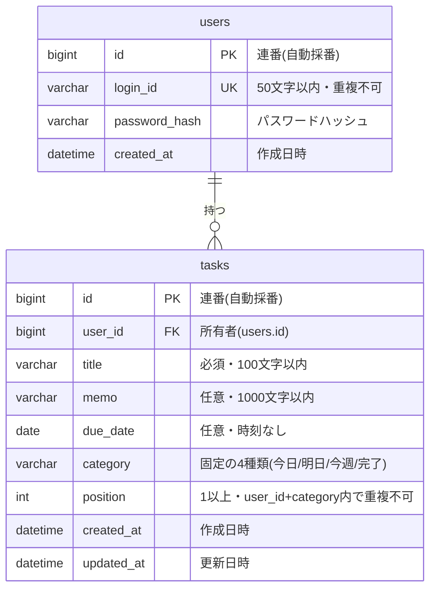

# DB 定義(データ設計・ER 図)

最終更新: 2026-11-17 / 状態: **完了(承認済み。コード実装は未着手)**

要件は [requirements.md](requirements.md)、画面は [screen-requirements.md](screen-requirements.md) を正とする。ラベルは同じ(【確定】=承認済み / 【提案】=承認待ち / 【未決定】=要検討)。

## 進め方

| 順 | 項目 | 状態 |
| --- | --- | --- |
| 1 | テーブル構成(users / tasks) | 確定(下記 1 章) |
| 2 | 並び順の持ち方 | 確定(下記 2 章) |
| 3 | 各項目の型・必須/任意・文字数 | 確定(下記 3 章) |
| 4 | ER 図(Mermaid)の確定 | 確定(下記 4 章) |

## 1. テーブル構成

- 【確定】データベースに「users」テーブルを作成し、アカウント情報を管理する
- 【確定】「tasks」テーブルは、所有者を示す「user_id」を持つ。各タスクは、user_id によって所有者と関連付ける
- 【確定】パスワードは、平文ではなく、安全なパスワードハッシュとして保存する
- 【確定】現時点では自分 1 人だけが利用するため、ユーザー登録画面は作らない。初期アカウントは、サーバー側で作成する
- 【確定】将来のマルチユーザー対応を妨げない構造にする
- 【確定】分類(今日・明日・今週・完了)は 4 つ固定のため、テーブルにはせず、tasks の項目として持つ想定
- 【未決定】ハッシュの方式(認証方式を決める段階で相談する)

## 2. 並び順の持ち方(確定)

- 【確定】タスクごとに、1, 2, 3, … という連番(position)を持つ
- 【確定】並び替えや、先頭への移動のたびに、影響するタスクの番号を振り直す
- 【確定】同じ分類の中で、番号が重ならないようにする(同じ user_id と category の中で、position は一意)
- 注: 振り直しの方法(1 回の通信でまとめて保存するか)は、API 設計の段階で整理する

## 3. 項目の定義(確定)

### users(アカウント)

| 項目 | 型 | 必須 | 内容・制約 |
| --- | --- | --- | --- |
| id | 数値の連番(自動採番) | 必須 | 主キー |
| login_id | 文字列(50 文字以内) | 必須 | ログイン用の ID。重複不可 |
| password_hash | 文字列 | 必須 | パスワードハッシュ(長さは、ハッシュの方式に合わせる) |
| created_at | 日時 | 必須 | 作成日時 |

### tasks(タスク)

| 項目 | 型 | 必須 | 内容・制約 |
| --- | --- | --- | --- |
| id | 数値の連番(自動採番) | 必須 | 主キー |
| user_id | 数値 | 必須 | users.id を指す(所有者) |
| title | 文字列(100 文字以内) | 必須 | タイトル |
| memo | 文字列(1,000 文字以内) | 任意 | メモ。空のときは、データなし |
| due_date | 日付(時刻なし) | 任意 | 期限日。空のときは、データなし |
| category | 文字列(固定の 4 種類の値のみ) | 必須 | 今日・明日・今週・完了に対応する固定の値 |
| position | 整数(1 以上) | 必須 | 同じ user_id・category の中で、重複不可 |
| created_at | 日時 | 必須 | 作成日時 |
| updated_at | 日時 | 必須 | 更新日時 |

- 【確定】タスクの削除は、物理削除(データそのものを消す)とする
- 【確定】上記の型・必須/任意・文字数・制約で確定する
- 【未決定】category の固定値の具体的な名前(英語表記など)、ハッシュの方式と、それに合わせた password_hash の長さ。いずれも、技術選定・認証方式の段階で決める

## 4. ER 図

補足(確定した制約):
- tasks の (user_id, category, position) は、重複不可
- 型の名前(bigint、varchar など)は、図を読みやすくするための仮の表記。実際の型は、データベースの選定後に決める

## 5. 承認結果と引き継ぎ事項

- 【確定】上記の ER 図を、データ設計の最終版として承認(2026-11-17)。users と tasks の 1 対多の関係、主キー・外部キーの定義、user_id・category・position による並び順の管理、将来のマルチユーザー対応を妨げない構造を確認済み
- 【確定】(user_id, category, position) の複合ユニーク制約は、実際の DB 構築時に、確実に設定する
- 【引き継ぎ】並び替え時の一時的な番号重複への対処(振り直しの手順)は、API 設計の段階で検討する
- 【引き継ぎ】category の固定値の具体的な名前、ハッシュの方式と password_hash の長さは、技術選定・認証方式の段階で決める

## 6. データの項目と入力ルール(旧 要件定義書 4.1.2)

- 【確定】タスクのデータ項目: タイトル、メモ、期限日(任意)、所属する分類。分類と期限日は独立した項目として持つ(テーブル・項目の定義は 上記 1〜4 章)
- 【確定】文字数の上限: タイトルは 100 文字まで、メモは 1,000 文字まで。PC・スマートフォンの両方で、同じ制限を適用する
- 【確定】文字数は、Unicode のコードポイント単位で数える。フロントエンドとバックエンドで、同じ数え方を採用する。組み合わせ絵文字などが複数文字として数えられる場合は、許容する
- 【確定】タイトル・メモともに、前後の空白を取り除いてから、文字数を数える。保存時にも、同じように前後の空白を取り除く(文字数の判定と保存で、同じ内容を対象にする。タイトルとメモで、扱いを統一する)
  - 取り除くのは、先頭と末尾の空白だけ。文中の空白や改行は、そのまま保持する
- 【確定】文字数の判定は、フロントエンドだけでなく、バックエンド側でも行う設計にする
- 【確定】入力欄では、上限を超える入力を受け付けず、入力欄の近くにエラーメッセージを表示する。バックエンドでも超過を判定し、超過していれば保存しない(最終チェック)
- 【確定】タイトルは必須項目とし、空欄での保存は不可
  - タイトルだけ入力されていれば保存できる。メモや期限日だけのタスクは作成できない
  - スペースだけのタイトルは、空欄と同じ扱いにする(前後の空白を取り除いた結果が空なら、保存不可)
  - 保存時には、タイトルの前後の不要な空白を取り除く
  - エラーメッセージを表示するのは、編集ダイアログだけ。PC・スマホの連続入力で、空欄(スペースだけを含む)のまま Return キーまたは「新規追加」を押した場合は、入力終了として扱い、エラーは表示しない
- 【確定】メモは任意項目とし、空欄でもタスクを保存できる。メモが空欄でも、エラーは表示しない。メモは、タスク追加後に、編集ダイアログから入力・変更する
- 【確定】上限を超える文字を貼り付けた場合: 入力欄には、上限までの文字を入力し、超過分は切り捨てる。文字数は、Unicode のコードポイント単位で数える
  - タイトル:「タイトルは100文字までです。」/ メモ:「メモは1,000文字までです。」
  - メッセージは、赤字で入力欄の近くに表示する。上限以内の入力に戻ったとき、または入力欄を閉じたときに、メッセージを消す
- 【確定】編集ダイアログでタイトルが空(前後の空白を除く)のときは、「タイトルを入力してください。」を、タイトル欄の近くに赤字で表示する(画面上の詳細は [screen-requirements.md](screen-requirements.md) 4.4)
