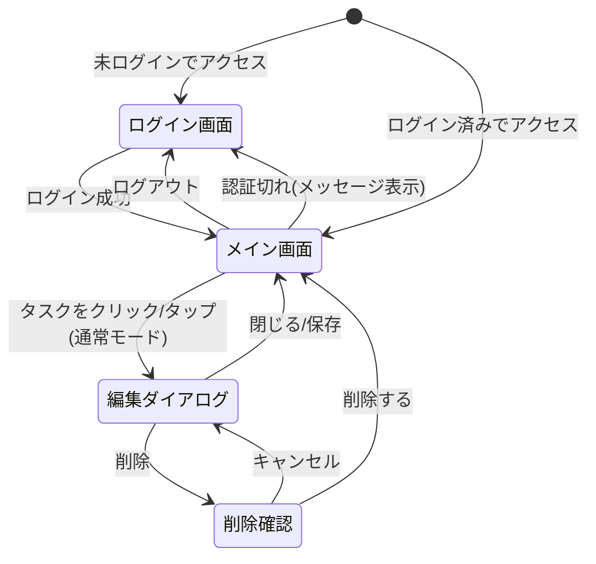

# 画面設計

最終更新: 2026-11-24

- 設計の状態: **確定**(色の値などデザインの細部は未決定)
- 実装の状態(試行): backend/ に試行環境(Java 25 / Spring Boot 4.0.10 / Gradle 9.9.2 / PostgreSQL 17 / Docker Compose)を作成済み(2026-11-22 時点。ビルド、PostgreSQL の起動、テーブルと制約の作成、再起動後の維持、Spring Boot からの DB 接続は確認済み。Hibernate の `validate` の成功は、ユーザーが報告した起動ログと設定値にもとづく判断で、起動ログ全文は未確認。Repository 経由のデータの読み書き、`DEFERRABLE` の動作、起動テストは未検証。API、Controller、Service、認証、タスク登録機能は未実装)。frontend/ に初期環境(React / Vite / JavaScript / npm / CSS Modules)を作成済み(2026-11-21 時点。ビルドと開発サーバーの起動、ブラウザでの初期画面の表示は確認済み。タスク管理の機能、API 連携、認証は未実装)。画面モックは prototype/ にもある。これらは試行であり、技術の採用確定ではない

ラベル: 【確定】=承認済み / 【提案】=承認待ち / 【未決定】=要検討。内容は分割前の要件定義書・画面設計書から移したもので、仕様は変えていない。

要件の全体は [requirements.md](requirements.md)、機能は [functional-requirements.md](functional-requirements.md)、データ設計は [database-design.md](database-design.md) を参照する。

章の構成(2026-11-21 に、画面一覧・画面遷移図・画面要件の 3 つの文書を、この 1 つの文書に統合した。章番号は、統合前から変わらない): 1 章=画面一覧、2 章=画面遷移、3〜5 章=ユースケース・画面仕様・状態、6 章=表示テーマ、7 章=操作方法(PC / スマートフォン)、8 章=画面設計の完了。

## 1. 画面一覧

| 分類 | 名称 | 備考 | ラベル |
| --- | --- | --- | --- |
| 画面 | ログイン画面 | 1人専用のパスワード認証。登録画面はなし | 確定 |
| 画面 | メイン画面 | 4 分類とタスク一覧。PC は横並び、スマホは縦積み | 確定 |
| 画面 | タスク編集(編集ダイアログ) | カードのクリック/タップで開く。形式はダイアログ(下記) | 確定 |
| 部品・ダイアログ | 削除確認ダイアログ | 編集ダイアログから呼び出す | 確定 |
| 部品・ダイアログ | 通知メッセージ(画面下・数秒で消える) | 分類間の移動後に表示(UC-06)。追加・編集・削除の成功では使わない(5.6)。エラー時と競合時は赤系で使う(5.4・5.5・5.7) | 確定 |
| 部品・ダイアログ | 破棄確認ダイアログ | 編集ダイアログで変更があるまま閉じようとしたときに表示(「変更を破棄しますか?」) | 確定 |
| 部品・ダイアログ | 移動先メニュー(スマホ) | 長押しで表示。今日/明日/今週/完了 | 確定 |
| 部品・ダイアログ | 入力操作バー(スマホ) | キーボード上、入力中のみ。「×」と「新規追加」 | 確定 |
| 部品・ダイアログ | ログアウト操作 | PC・スマホの両方に設ける。メイン画面のヘッダー右側に配置(本書 4.1 章) | 確定 |
| 状態表示 | 読み込み中、保存中、保存失敗、通信エラー、認証切れ | 5 章と 2.1 章で確定 | 確定 |

## 1.1 編集ダイアログの形式

- 【確定】ダイアログ(メイン画面の上に重ねて表示)とする。メイン画面の状態(スクロール位置など)を維持し、タスク一覧と編集ダイアログを自然に行き来できるようにするため
- 【確定】PC: 画面中央に表示する小さなダイアログ
- 【確定】スマホ: 画面の大部分を覆う、全画面に近いダイアログ
- 【確定】スマホでは、キーボード表示時に入力欄や操作ボタンが隠れないように配慮する
- 【確定】保存の方式、ダイアログの閉じ方、入力途中で閉じたときの扱いは、UC-04 で確定(「保存」ボタンで保存。閉じる操作は「閉じる」ボタン・ダイアログ外のタップ・Esc キー。変更があるときは破棄確認ダイアログ)

## 1.2 ログアウト

- 【確定】ログアウト操作を設ける。PC・スマホの両方から使い、インターネット上に公開するため、必要なときに自分でログイン状態を終了できるようにする
- 【確定】ログアウト時は、ログイン画面に戻すだけでなく、サーバー側でも認証セッション(ログイン状態)を無効化する
- 【確定】ボタンの配置: メイン画面のヘッダー右側(PC・スマホ共通。本書 4.1 章)
- 【確定】ログアウト時の確認ダイアログは設けない(確認なしで、すぐログアウトする。UC-08)
- 注: 認証方式(セッション方式かトークン方式か等)は未決定。上記の「無効化」は、方式に関わらず、ログアウト後にサーバー側でそのログイン状態を使えなくする要件として扱う

## 2. 画面遷移

### 2.1 認証切れ時の動き

- 【確定】認証切れ(ログイン状態の期限切れ)を検知したら、ログイン画面へ移動する
- 【確定】ログイン画面に「ログインの有効期限が切れました」などのメッセージを表示する(文言は UC-09 で確定)
- 【確定】再ログインに成功したら、メイン画面へ戻す
- 【確定】認証切れによって保存できなかった操作は、自動的に再実行しない
- 【確定】入力途中の未保存内容は、失われることを許容する
- 【確定】入力内容の一時保持や、中断した操作の再開機能は、今回は対象外とする

### 2.2 遷移図

すべて【確定】。

### 2.3 遷移の一覧

| 遷移元 | きっかけ | 遷移先 | ラベル |
| --- | --- | --- | --- |
| ログイン画面 | ログイン成功 | メイン画面 | 確定(認証切れ後の再ログインはメイン画面へ戻す) |
| メイン画面 | 認証切れを検知 | ログイン画面(メッセージ表示) | 確定 |
| メイン画面 | ログアウト操作 | ログイン画面 | 確定 |
| メイン画面 | タスクのクリック/タップ(通常モード) | 編集ダイアログ | 確定 |
| 編集ダイアログ | 削除 | 削除確認ダイアログ | 確定 |
| 未ログインで開いたとき | メイン画面の URL にアクセス | ログイン画面 | 確定 |
| ログイン済みで開いたとき | ログイン画面の URL にアクセス | メイン画面 | 確定 |
| 編集ダイアログ | 閉じる/保存 | メイン画面(ダイアログが閉じる) | 確定(閉じ方・保存方式は UC-04) |
| 削除確認ダイアログ | キャンセル | 編集ダイアログ | 確定 |
| 削除確認ダイアログ | 「削除する」 | メイン画面(ダイアログが閉じる) | 確定(遷移図に含めて承認) |
| 編集ダイアログ | 変更があるまま閉じる操作 | 破棄確認ダイアログ | 確定(UC-04) |
| 破棄確認ダイアログ | 「破棄する」 | メイン画面(変更を保存せず閉じる) | 確定(UC-04) |
| 破棄確認ダイアログ | 「編集を続ける」 | 編集ダイアログ(入力内容を維持) | 確定(UC-04) |

## 3. ユースケース・操作フロー

PC・スマホの操作仕様は、本書 7 章の確定内容を維持する。ここでは「誰が何をするか」を、一連の流れとして整理する。

### 3.1 ユースケース一覧

利用者は、自分(1人専用)のみ。

| ID | ユースケース | 関連する確定仕様 | ラベル |
| --- | --- | --- | --- |
| UC-01 | ログインする | 1人専用のパスワード認証 | 確定 |
| UC-02 | タスク一覧を確認する | 4 分類の表示。「完了」分類の確認や、期限切れの強調表示を含む | 確定 |
| UC-03 | タスクを追加する(連続入力) | PC: 追加ボタン / スマホ: 入力開始エリア | 確定 |
| UC-04 | タスクを編集する | 編集ダイアログ(タイトル・メモ・期限日) | 確定 |
| UC-05 | タスクを削除する | 確認ダイアログあり | 確定 |
| UC-06 | タスクを別の分類へ移動する | PC: ドラッグ&ドロップ / スマホ: 長押しメニュー | 確定 |
| UC-07 | 同じ分類内で並び替える | PC: ドラッグ&ドロップ / スマホ: 編集モード | 確定 |
| UC-08 | ログアウトする | サーバー側でもログイン状態を無効化 | 確定 |
| UC-09 | 認証切れから再ログインする | ログイン画面へ移動し、再ログイン後メイン画面へ | 確定 |

整理の経緯:
- 「完了タスクを確認する」は、メイン画面の「完了」分類を確認する操作として、UC-02 に含める
- 「期限切れのタスクに気づく」は独立させず、UC-02 の期限切れ表示として扱う

### 3.2 操作フロー

ユースケースごとに、1つずつ確認しながら記載する(UC-01 から順に)。

| ID | 状態 |
| --- | --- |
| UC-01 | 確認済み |
| UC-02 | 確認済み |
| UC-03 | 確認済み |
| UC-04 | 確認済み |
| UC-05 | 確認済み |
| UC-06 | 確認済み |
| UC-07 | 確認済み |
| UC-08 | 確認済み |
| UC-09 | 確認済み |

#### UC-01 ログインする

基本の流れ(PC・スマホ共通):

1. 未ログインで URL を開く → ログイン画面が表示される(確定: 2 章)
2. ID とパスワードを入力し、ログインを実行する【提案: 入力項目は ID・パスワードの2つ】
3. 認証に成功すると、メイン画面へ移動する(確定: 2 章)

失敗時:

- 【確定】ログインに失敗した場合は、ID とパスワードのどちらが誤りでも、同じメッセージ「ID またはパスワードが正しくありません」を表示する(ID の存在を第三者に推測されにくくするため)
- 【確定】ログイン失敗時の入力欄の扱い: ID 入力欄は入力内容を維持し、パスワード入力欄は入力内容をクリアする(ID の再入力の手間を省きつつ、パスワードを画面に残さないため)
- 【確定】メッセージの表示位置: ログイン画面の見出しと ID 入力欄の間(4.2 章)
- 失敗回数の制限(総当たり対策)は、確定済みの方針([tech-stack.md](tech-stack.md) 4 章)に基づき、認証方式の選定時に具体化する

ログインの実行方法(確定):

- ログインボタンを押すと、ログイン処理を実行する
- ID 入力欄で Return キーを押すと、パスワード入力欄へ移動する
- パスワード入力欄で Return キーを押すと、ログイン処理を実行する
- iPhone でも同様に、キーボードの「開く」「Go」などのキーで操作できるようにする

ログイン処理中の表示(確定):

- ログインボタンを無効化し、表示を「ログイン中…」に変更する
- Return キーや iPhone の Go キーによる再送信も受け付けない
- ID・パスワードの入力欄も、処理中は変更できないようにする
- 通信エラーなど、サーバーから正常な応答がない場合の表示は、5.5 で確定

パスワードの表示/非表示(確定。PC・スマホ共通):

- 初期状態は非表示
- 入力欄右端の目のアイコンで、表示/非表示を切り替える。もう一度操作すると非表示に戻る
- ログイン失敗時は、パスワード欄をクリアし、非表示状態に戻す
- ログイン処理中は、切り替え操作も無効化する

パスワード自動入力(確定):

- Mac・iPhone の Safari で、iCloud キーチェーンによる ID・パスワードの自動入力に対応する
- 標準的なログインフォームにして、Safari が認証情報の保存・自動入力を判断できるようにする
- アプリ側でパスワードを独自に保存しない
- 認証情報を保存するかどうかは、Safari 側での利用者の選択に任せる

UC-01 の確認は完了。

#### UC-02 タスク一覧を確認する

基本の流れ:

1. ログイン後、メイン画面が表示される(確定: 2 章)
2. 「今日」「明日」「今週」「完了」の 4 分類に、タスクが並んで表示される。PC は横並び、スマホは縦に積む(確定)
3. 各分類の中のタスクは、保存された並び順で表示される(確定)
4. 期限日を過ぎた未完了タスクは、期限日が赤色などで強調される。「完了」のタスクは強調されない(確定)
5. 「完了」分類のタスクも、削除するまで残り、同じ画面で確認できる(確定)

カードの表示仕様(確定。一覧の視認性を優先し、カードはできるだけコンパクトにする):

- タイトル: 常に表示する。2 行以内に収まる場合はそのまま表示し、2 行を超える場合は末尾を「…」で省略する。全文は編集ダイアログで確認できる
- 期限日: 設定されている場合のみ表示
- メモ本文: 一覧には表示しない
- メモアイコン: メモが入力されている場合のみ、小さなアイコンを表示する
- 期限切れ: 未完了タスクの期限日を、赤い文字で強調し、期限日の前に小さな警告アイコン「!」を付ける(4.1 章参照)
- 完了タスク: 期限切れの強調は行わない

分類見出しの件数表示(確定):

- 今日・明日・今週・完了のすべての見出しに、件数を表示する。形式は「今日 3」のように、分類名の横に件数を置く
- 0 件の場合も「0」と表示する
- タスクの追加・削除・分類間の移動に応じて、リアルタイムに更新する
- 同じ分類内での並び替えでは、件数は変化しない

0 件の分類の表示(確定。画面の情報量を抑え、シンプルな表示を優先する):

- PC: 空の分類でも「タスクを追加」ボタンを表示する
- PC: 空の列にもタスクをドラッグ&ドロップできる十分な領域を確保する
- スマホ: 既定のタスク入力開始エリアだけを表示する
- 「タスクはありません」などの説明文は表示しない
- 「完了」分類も同じ扱いとする

スクロール(確定。ドラッグ&ドロップの操作性と、PC・スマホ間の挙動の統一を優先する):

- PC: 4 分類を横並びにし、ページ全体を縦スクロールする
- スマホ: 4 分類を縦に積み、ページ全体を縦スクロールする
- 各分類の列・リストは、個別に縦スクロールさせない
- PC で、タスク数の違いによって列の下部に空白が生じることは許容する

読み込み中の表示と、読み込み失敗時の表示は、5.1・5.5 で確定。

UC-02 の確認は完了。

#### UC-03 タスクを追加する(連続入力)

PC の流れ(確定: 本書 7 章):

1. 分類の列の「タスクを追加」ボタンを押す
2. 列の末尾に入力欄が表示され、その場でタスク名を入力する(別画面は開かない)
3. Return で確定すると、タスクが列の末尾に追加され、次の入力欄が表示される(連続入力)
4. 入力欄の外をクリックすると、入力内容を保存して終了する。空欄(前後の空白のみを含む)のまま Return で入力終了。Esc で入力内容を破棄して終了する

分類の種類にかかわらず(「完了」を含む)、同じ操作で追加できる(確定: 本書 7 章)。

スマホの流れ(確定: 本書 7 章):

1. 分類の末尾の入力開始エリアをタップする
2. その場でテキスト入力状態になり、キーボードと入力操作バーが表示される
3. Return、または操作バーの「新規追加」で確定すると、タスクが追加され、次の入力欄が表示される(連続入力)
4. 空欄のまま Return/「新規追加」、または入力欄の外をタップで終了する(入力途中の文字は保存)。操作バーの「×」で入力内容を破棄して終了する
5. 編集モード中は使用できない

入力ルール(確定): タイトルは 100 文字まで(超過は受け付けず、入力欄の近くにエラーを表示)。前後の空白は取り除いて保存する。メモ・期限日は追加後に編集ダイアログで入力する。

PC の入力中のボタンの扱い(確定。入力中の画面をシンプルに保ち、操作に集中できる構成にする):

- 入力開始時に、「タスクを追加」ボタンを入力欄に置き換える
- 連続入力中は、確定したタスクが列に並び、次の入力欄が表示される
- 入力欄は、常に追加ボタンがあった位置(列の末尾)に表示する
- 入力終了後は、「タスクを追加」ボタンを元の位置に戻す

連続入力中の自動スクロール(確定。PC・スマホ共通):

- 新しい入力欄が画面の下端に近づいたら、自動で見える位置までスクロールする
- スマホでは、キーボードと入力操作バーに隠れない位置に表示する

スマホの入力欄の見た目(確定):

- 入力欄の先頭に「・」を表示した、1 行の入力欄にする
- 確定したタスクも、同じ箇条書き形式(「・」付き)で並べる
- 次の入力欄は、常にリストの末尾に表示する
- 入力はその場で行い、別画面やモーダルは使わない

確定したタスクの表示(確定):

- 入力中は「・」付きの箇条書き形式で表示する
- タスクが確定したあとは、UC-02 で決めた通常のカード表示に切り替える
- タイトル・期限日・メモアイコンの表示ルールは、UC-02 に従う
- PC・スマホともに同じ考え方とする

切り替えのタイミング(確定):

- 連続入力中は、確定済みのタスクも含めて「・」付きの箇条書き形式で表示する
- Return で確定したタスクは、そのまま箇条書き形式で並べる
- 入力を終了したら、追加したタスクを含む一覧全体を、UC-02 の通常のカード表示に切り替える
- 入力を終了する操作は、既定の仕様(入力欄の外のタップ、空欄での Return など)に従う

既存タスクの表示(確定):

- 連続入力中も、既存のタスクは UC-02 の通常のカード表示を維持する
- 今回追加したタスクだけ、「・」付きの箇条書きで表示する
- 入力終了後は、分類内の一覧全体を通常のカード表示に切り替える

PC の入力中の見た目(確定。PC・スマホで表示ルールを統一する):

- 連続入力中は、入力欄の先頭に「・」を付ける
- 今回追加したタスクも、「・」付きの箇条書きで並べる
- 既存のタスクは、通常のカード表示を維持する
- 入力終了後は、分類内の一覧全体を、UC-02 の通常のカード表示に切り替える

追加の保存に失敗したときの表示は、5.2・5.4 で確定。

UC-03 の確認は完了。注: 上記の確定により、本書 7 章の PC の表(「列の末尾に入力欄」)は、この見た目の仕様を前提に読む。

#### UC-04 タスクを編集する

基本の流れ(確定: 2 章、本書 7 章):

1. 通常モードで、タスクのカードをクリック(PC)/タップ(スマホ)する
2. 編集ダイアログが開く。PC は画面中央の小さなダイアログ、スマホは全画面に近いダイアログ
3. タイトル・メモ・期限日を変更する(期限日は任意)
4. 保存する、または閉じると、メイン画面に戻る
5. 削除する場合は UC-05 へ

入力ルール(確定): タイトルは必須(前後の空白を除いて空なら保存不可。エラーを表示)、100 文字まで。メモは任意、1,000 文字まで。上限超過は受け付けず、入力欄の近くにエラーを表示する。

編集モード中(スマホ)は、タップしても何も起きない(確定)。

保存の方式(確定):

- 編集ダイアログの「保存」ボタンを押したときに保存する。入力中の変更は、保存ボタンを押すまで確定しない
- 「閉じる」や「キャンセル」では、変更を保存しない
- タイトルが空(前後の空白を除く)、または文字数の上限を超えている場合は、保存操作時にエラーを表示する
- 保存に成功したら、編集ダイアログを閉じ、メイン画面に戻る
- 注: 文字数の上限は、入力時にも超過を受け付けない(要件で確定済み)。保存時のエラーは、サーバー側の判定(要件で確定済み)を含む最終チェックとして扱う

変更したまま閉じるとき(確定):

- 対象の操作は、「閉じる」ボタン、ダイアログ外のタップ、Esc キーのすべて
- 変更がない場合は、確認なしで閉じる
- 変更がある場合は、「変更を破棄しますか?」と確認する(破棄確認ダイアログ)
- 「破棄する」を選ぶと、変更を保存せずにダイアログを閉じる
- 「編集を続ける」を選ぶと、編集ダイアログに戻り、入力内容を維持する

期限日の入力方法(確定。Mac・iPhone で同じ仕様):

- 日付入力欄をタップ/クリックすると、Safari 標準の日付選択 UI を表示する
- 期限日は任意項目とする
- 入力欄の横に「クリア」操作を設け、設定済みの期限日を空に戻せるようにする
- 過去の日付も設定できる

編集ダイアログの配置(確定。PC・スマホ共通):

- 上部に操作バーを置き、左側に「閉じる」、右側に「保存」を配置する
- 入力欄は、上から「タイトル → 期限日 → メモ」の順にする
- 削除操作は、ダイアログの一番下に配置する。赤文字など、注意を促す控えめなデザインにする
- スマホでキーボードを表示しても、上部の操作バーは隠れないようにする

「保存」ボタンの状態(確定):

- 「保存」ボタンは、常に押せる
- 変更がない状態で押した場合は、保存の通信を行わず、そのまま編集ダイアログを閉じる
- 変更がある場合は、通常どおり保存処理を行う

保存中の二重送信の防止と、保存失敗時の表示は、5.3 で確定。

UC-04 の確認は完了。

#### UC-05 タスクを削除する

基本の流れ(確定: 2 章、functional-requirements.md F-04):

1. 編集ダイアログの一番下にある、削除の操作を行う
2. 削除確認ダイアログが表示される(誤操作防止)
3. 「削除する」を選ぶと、タスクが削除され、メイン画面に戻る(分類の件数も更新される)
4. キャンセルすると、編集ダイアログに戻る

削除できるタスク: すべての分類のタスク(「完了」を含む)。一括削除は今回は対象外(確定: functional-requirements.md F-08)。

削除確認ダイアログ(確定):

- 表示文: 「『○○○』を削除しますか?」(○○○はタスクのタイトル)
- 注意書き: 「この操作は元に戻せません」
- ボタンは、赤い「削除する」と「キャンセル」の 2 つ
- 「削除する」で完全に削除し、メイン画面に戻る
- 「キャンセル」では削除せず、編集ダイアログに戻る
- 削除したタスクを復元する機能は実装しない

未保存の変更がある状態で削除するとき(確定):

- 編集中に変更があっても、変更破棄の確認は挟まず、削除確認だけを表示する
- 削除確認ダイアログには、編集前の保存済みタイトルを表示する
- 「削除する」で、未保存の変更も含めて、タスクを完全に削除する
- 「キャンセル」では削除せず、編集ダイアログに戻る。このとき、編集中の内容は維持する
- 削除確認ダイアログでは、保存済みのタイトル全文を折り返して表示する(省略しない)

削除中の二重送信の防止と、削除失敗時の表示は、5.3 で確定。

UC-05 の確認は完了。

#### UC-06 タスクを別の分類へ移動する

PC の流れ(確定: 本書 7 章):

1. タスクのカードをドラッグして、別の分類の列にドロップする
2. タスクが移動先の分類に入り、配置ルールで決まる位置に置かれる(今日=一番上、明日=一番下、今週=一番下、完了=一番上)
3. 移動元・移動先の件数が更新される

スマホの流れ(通常モード。確定: 本書 7 章):

1. タスクのカードを長押しする
2. 移動先メニュー(今日/明日/今週/完了)が表示される
3. 移動先を選ぶと、タスクが移動し、配置ルールで決まる位置に置かれる
4. 通常のスクロールとは干渉しない。編集モード中は、分類間の移動はできない

PC のドラッグ中の見た目(確定):

- ドラッグ中、カーソルが乗っている移動先の列を、枠や背景色で強調する
- ドラッグ中のカードは、半透明にして、浮いているように表示する
- ドロップした位置によって、移動後の配置は変えない。確定済みの分類別の配置ルールに従う
- 同じ分類の中でのドラッグは、並び替え(UC-07)として扱う。並び替え位置を示す目印は、UC-07 で別途決める

スマホの移動先メニュー(確定):

- 「今日・明日・今週・完了」の 4 項目を、常に表示する
- 現在の分類には「(現在)」を付け、グレーアウトして選択できないようにする
- 他の 3 項目は選択できる
- メニュー以外の場所をタップするか、「キャンセル」を選ぶと、何も変更せずにメニューを閉じる

長押しの時間(確定):

- 長押しの開始から約 0.5 秒で、移動先メニューを表示する
- 指のわずかな動きは許容する
- 指の移動量が大きい場合は、長押しではなくスクロールとして扱う
- 正確な時間や移動量の判定は、実機で操作して調整できるようにする

移動後の通知(確定。PC・スマホ共通):

- 画面下に、短いメッセージを数秒間表示する。例:「『○○○』を『完了』に移動しました」
- 移動したタスクのタイトルと、移動先の分類名を表示する
- 数秒後に自動的に消える。表示中も、ほかの操作を妨げない
- 「元に戻す」機能は付けない

同じ通知メッセージを追加・編集・削除の成功で使うかは、5.6 で確定(使わない)。移動の保存に失敗したときの表示は、5.2・5.4 で確定。

UC-06 の確認は完了。

#### UC-07 同じ分類内で並び替える

PC の流れ(確定: 本書 7 章):

1. タスクのカードを、同じ分類の列の中でドラッグして、上下の好きな位置にドロップする
2. 並び順が変わり、保存される(件数は変わらない)

スマホの流れ(確定: 本書 7 章):

1. 各分類の「編集」ボタンを押すと、画面全体が編集モードになる
2. 編集モード中は、タスクを長押ししてドラッグし、同じ分類内で上下の並び順を変更できる(分類間の移動、タスクの追加、タップによる編集ダイアログの表示はできない)
3. 「編集終了」ボタンで、画面全体が通常モードに戻る

PC の並び替え位置の目印(確定):

- ドラッグ中、ドロップできる位置(カードの間)に、横線(挿入線)を表示する
- ドロップすると、挿入線が示す位置にカードを配置する
- ドラッグ中のカードは、半透明にして、浮いて見えるようにする
- 他の列に移動する場合の強調表示は、UC-06 で確定した仕様に従う

スマホの「編集」「編集終了」ボタン(確定):

- 通常時は、各分類の見出しの右端に、「編集」ボタンを表示する
- どの分類の「編集」を押しても、画面全体が編集モードになる
- 編集モード中は、すべての分類のボタンを「編集終了」に切り替える
- どの分類の「編集終了」を押しても、画面全体が通常モードに戻る

編集モードであることの示し方(確定):

- 通常モードでは、「≡」アイコンを表示しない
- 編集モード中は、すべてのカードの右端に、並び替えを示す「≡」アイコンを表示する
- ドラッグ操作の対象は、カード全体とし、アイコン部分だけに限定しない
- スマホでは、カードを長押ししてドラッグすることで、同じ分類内の並び替えを行う

編集モード中の入力開始エリア(確定):

- 編集モード中は、「＋」の入力開始エリアを非表示にする。タスクの追加操作はできない
- 「編集終了」で通常モードに戻ったら、各分類の末尾に入力開始エリアを再表示する
- 入力開始エリア以外のレイアウトやカード表示は、確定済みの仕様に従う

スマホの並び替え中の見た目(確定。PC・スマホで並び替え中の表示ルールを統一する):

- ドラッグ中のカードは、半透明にして、浮いて見えるようにする
- 挿入位置には、カードの間に横線(挿入線)を表示する
- ドロップすると、挿入線が示す位置にカードを配置する

ドラッグ中の自動スクロール(確定):

- 対象は、PC のドラッグ&ドロップ(UC-06・UC-07)と、スマホの並び替え(UC-07)の両方
- カードを画面の上端に近づけると上方向、下端に近づけると下方向へ、自動でスクロールする
- ドラッグを続けたまま、離れた位置まで移動できるようにする
- スクロールを始める範囲や速度は、実機で操作して調整できるようにする

並び替えの保存に失敗したときの表示は、5.2・5.4 で確定。

UC-07 の確認は完了。

#### UC-08 ログアウトする

基本の流れ(確定: 1.2 章、2 章):

1. メイン画面のヘッダー右側にある「ログアウト」を押す
2. サーバー側で、ログイン状態を無効化する
3. ログイン画面へ移動する
4. 以降、メイン画面の URL を開いても、ログイン画面へ移動する(未ログイン扱い)

ログアウト時の動き(確定):

- ログアウトのボタンを押したら、確認なしですぐログアウトする
- ログアウト時は、サーバー側でログイン状態を無効化する。その後、ログイン画面へ移動する
- 保存済みのタスクデータは削除せず、サーバーに保持する
- ボタンの配置は、メイン画面のヘッダー右側(4.1 章)。誤操作を防ぐため、タスクの操作から離れた位置に置く

ログアウト失敗時の表示は、5.5 で確定。

UC-08 の確認は完了。

#### UC-09 認証切れから再ログインする

基本の流れ(確定: 2.1 章):

1. メイン画面で操作中に、ログイン状態が切れる
2. 次の操作でサーバーに送ったとき、認証切れが検知され、ログイン画面へ移動する。「ログインの有効期限が切れました」などのメッセージを表示する
3. ID とパスワードを入力して再ログインする(UC-01 と同じ操作)
4. 成功したら、メイン画面へ戻る。認証切れで保存できなかった操作は、自動で再実行しない。入力途中の内容は失われてよい

認証切れを検知するタイミング(確定):

- タスクの追加・編集・削除・移動など、サーバーへ操作を送信したタイミングで、認証状態を確認する
- サーバーから認証切れの応答が返った場合は、ログイン画面へ遷移する
- 画面を開いたまま放置している間は、定期的な認証確認を行わない
- 認証切れによって失敗した操作は、保存せず、自動再実行もしない
- 再ログイン後は、メイン画面へ戻る

認証切れのメッセージ(確定。操作が失敗した場合と、単に認証切れが判明した場合で使い分ける):

- サーバーへの操作中に認証切れが発生した場合: 「ログインの有効期限が切れました。直前の操作は保存されていません。もう一度ログインしてください。」
- 操作を行わず、画面を開いた際に認証切れが判明した場合: 「ログインの有効期限が切れました。もう一度ログインしてください。」

メッセージの表示位置は、ログイン画面の見出しと ID 入力欄の間(4.2 章)。

UC-09 の確認は完了。これで 3 章(ユースケース・操作フロー)の確認は完了。

## 4. 画面仕様

画面ごとに、PC・スマホ別の配置・表示内容を決める。3 章で確定した内容は、そのまま前提とする。

進め方: メイン画面 → ログイン画面 → 各ダイアログの順に、1 項目ずつ確認する。

### 4.1 メイン画面

ヘッダー(確定。PC・スマホ共通):

- 細いヘッダーを置く。左側にアプリ名、右側に「ログアウト」を配置する
- ヘッダーは画面上部に固定せず、ページのスクロールとともに流れる
- 「編集」ボタンは、確定済みのとおり、各分類の見出しの右端に配置する(スマホ)
- 注: ログアウトの配置は、この確定により、UC-08・1.2 章の未決定を解消する

アプリ名(確定):

- アプリ名は「タスク管理」とする。ヘッダー左側に表示する
- ブラウザのタブ名、ログイン画面の見出しにも、同じ名称を使用する
- 将来的にアプリ名を変更できる前提とする(名称を 1 か所で管理する設計が望ましい)

表示と操作の切り替え基準(確定):

- 表示レイアウトは、画面幅で決める。画面幅に応じて、4 分類を横並び・縦積みに切り替える
- 操作方法は、入力デバイスで決める
  - タッチ操作: スマホ向けの操作(長押しメニュー、編集モード)を使う
  - マウス操作: PC 向けの操作(ドラッグ&ドロップ)を使う
- Mac は、ウィンドウ幅に関係なく、マウス操作の仕様を維持する
- iPhone は、画面の向きに関係なく、タッチ操作の仕様を維持する
- 注: 「編集」ボタンや入力開始エリアなど、スマホ向けの部品は、タッチ操作のときに表示する想定。縦積みでマウス操作のとき(Mac で幅を狭くした場合)の部品の出し分けは、下記「縦積み+マウス操作のときの部品」で確定

横並びと縦積みの切り替え幅(確定):

- 画面幅 1000px 以上: 4 分類を横並びにする
- 画面幅 1000px 未満: 4 分類を縦積みにする
- 1000px は目安とし、実機で確認して調整できるようにする

縦積み+マウス操作のときの部品(確定。操作方式に合わせる):

- 各分類の末尾に、PC 向けの「タスクを追加」ボタンを表示する
- スマホ向けの入力開始エリアと「編集」ボタンは、表示しない
- 分類間の移動と、同じ分類内の並び替えは、ドラッグ&ドロップで行う
- ページ全体のスクロールを使い、縦積みの分類間もドラッグ&ドロップで移動できるようにする

分類見出しの配色(確定):

- 「今日・明日・今週・完了」の見出しは、色分けせず、同じ配色(同じトーン)にする
- 分類名と件数によって区別する
- 色は、期限切れなど、意味のある状態を示す場合に使用する
- ライトモード・ダークモードの両方で、統一感を保つ

アクセントカラー(確定):

- 「保存」などの操作ボタンや、押せる部品に、緑系の色を使用する
- ライトモード・ダークモードの両方で、見やすい緑にする
- 期限切れを示す赤とは、明確に区別する
- 具体的な色の値は、画面の細部を決める段階で調整する

期限切れの示し方(確定。色だけに頼らない):

- 期限日の文字色は、赤で強調する
- 期限日の前に、警告アイコン「!」を付ける(赤と緑は、色だけでは区別しにくい人がいるため、色以外の手がかりを併用する)
- 対象は、未完了のタスクのみ。完了済みのタスクには、赤文字・警告アイコンのどちらも表示しない
- ライトモード・ダークモードの両方で、視認できるようにする

背景の配色(確定):

- ダークモード: 画面全体の背景は、真っ黒ではなく、濃いグレーにする。カードは、背景より少し明るいグレーにして、境目を分かりやすくする
- ライトモード: 背景は白に近い明るいグレー、カードは白にする
- ライト・ダークともに、文字や操作ボタンの視認性を確保する
- 具体的な色の値は、画面の細部を決める段階で調整する

列の幅(確定):

- 横並び(1000px 以上): 4 列の幅を、画面幅に応じて伸縮させる
- 1 列あたりの最大幅は、約 350px とする。最大幅に達した場合は、4 列全体を中央に配置する
- 縦積み(1000px 未満): 各列を、画面幅いっぱいにする(左右に小さな余白を設ける)
- 正確な寸法は、実機で確認して調整できるようにする

カード内の配置(確定):

- 1 行目: タスクのタイトル(最大 2 行。超える分は「…」で省略)
- 2 行目: 左端に期限日、右端にメモアイコンを配置する
- 期限日がない場合は、期限日の表示を省略する。メモがない場合は、メモアイコンを表示しない
- 期限日もメモもない場合は、タイトルだけのカードにする
- メモだけがある場合は、2 行目の右端にメモアイコンだけを表示する
- 期限切れの場合は、期限日の前に「!」を付けて、赤文字で表示する

期限日の表示形式(確定。カード上のみ):

- 今年の日付は、「11/20」の形式で表示する
- 今年以外の日付は、「2027/1/5」のように、年も表示する
- 期限切れの場合も、日付の形式は変えず、「!」付きの赤文字で表示する
- 編集ダイアログの日付入力の形式には、影響させない(Safari 標準の日付選択)

カードの高さ(確定。PC・スマホ共通の考え方):

- タイトルだけのカードも、上下の余白で、最低高さ約 44px を確保する
- タイトルが 2 行になる場合は、内容に応じて、カードの高さを広げる
- カード間には、数 px の余白(すき間)を設ける
- 具体的な寸法は、実機で調整できるようにする

メイン画面の仕様は、ここまでで一通り確定。未決定の細部(分類の見出しの文字の大きさ、「タスクを追加」ボタンの見た目など)は、デザインの細部を決める段階で扱う。

### 4.2 ログイン画面

レイアウト(確定。PC・スマホ共通):

- 画面の中央に、小さなカードを配置する。ヘッダーは設けない
- 上から、「タスク管理」の見出し、ID 入力欄、パスワード入力欄、ログインボタンの順に配置する
- パスワード欄の右端に、表示・非表示を切り替える目のアイコンを配置する
- エラーメッセージや認証切れのメッセージは、見出しと ID 入力欄の間に表示する
- 配色は、確定済みのライト・ダークモードと、緑のアクセントカラーに従う

パスワードを忘れたとき(確定):

- ログイン画面には、パスワードを忘れた場合の案内や、再設定のリンクを設けない
- パスワードを忘れた場合は、開発者(自分)が、サーバー側の設定またはデータベースから再設定する
- メールによる再設定機能は、実装しない
- パスワードの初期設定・変更の方法は、認証方式を決める段階で、運用手順として整理する

スマホでキーボードが出たとき(確定):

- iPhone でキーボードが表示されたときは、ログインカードを必要に応じて画面上部へ移動する
- ID・パスワードの入力欄とログインボタンが、キーボードに隠れないようにする
- iPhone の横向きでも、同じ考え方で調整する
- キーボードを閉じたら、通常の配置に戻す

4.2 ログイン画面の仕様は、ここまでで一通り確定。

### 4.3 ダイアログ・部品

対象: 編集ダイアログ、削除確認ダイアログ、破棄確認ダイアログ、スマホの移動先メニュー、通知メッセージ、スマホの入力操作バー。

PC の編集ダイアログ(確定):

- 幅は約 480px で、画面の中央に配置する
- 背後のメイン画面には、薄い黒のオーバーレイ(幕)を表示する
- ダイアログの表示中は、背後の画面のスクロールと操作を無効にする
- ダイアログの高さは、内容に応じて調整する。画面内に収まらない場合は、ダイアログの内部だけをスクロールできるようにする

スマホの編集ダイアログ(確定):

- 画面の下からせり上がる「シート」形式にする
- 画面の上端に、約 40px の余白を残す。上部の角は丸くする
- 背後のメイン画面は暗くし、スクロールと操作を無効にする
- キーボードが表示されている間も、入力欄と上部の操作バーが隠れないようにする
- 「閉じる」「保存」の操作バーは、上部に固定する

確認ダイアログ(削除確認・変更破棄確認。確定。PC・スマホ共通):

- 画面の中央に、小さく表示する。幅は約 320px を目安にする
- メッセージを上に、ボタン 2 つを下に横並びで配置する
- 背後の編集ダイアログとメイン画面は、さらに暗くする
- 削除確認と変更破棄確認で、共通のデザインにする
- 削除ボタン(「削除する」)は、赤色にする

スマホの移動先メニュー(確定。アクションシート形式):

- 画面の下から出る、アクションシート形式にする
- 「今日」「明日」「今週」「完了」を縦に並べる。現在の分類は「(現在)」付きでグレー表示し、選択できないようにする
- その下に、「キャンセル」を配置する
- 背景を暗くし、メニューの外をタップすると閉じる
- メニューの表示中は、移動対象のカードを少し強調して表示する

通知メッセージ(確定。移動後に表示。PC・スマホ共通):

- 画面の下端の中央に表示する。スマホでは、ホームバーの上に少し余白を設ける
- 約 3 秒で、自動的に消える。タップ・クリックで、即時に閉じる
- 角丸の細長い帯状のデザインにする。ライト・ダークモードに合わせた、控えめな配色にする
- 表示中も、ほかの操作を妨げない
- 続けて移動した場合は、新しい通知で、前の通知を置き換える

スマホの入力操作バー(確定):

- 高さは約 44px
- 左の「×」は、グレーのアイコンのみ。タップできる範囲は、アイコンより広くする
- 右の「新規追加」は、緑色の文字のボタンにする。入力欄が空の場合は、グレー表示にし、押すと入力を終了する
- 背景は、カードより少し濃いグレーとし、上端に細い境界線を設ける。ダークモードでは、背景を少し明るいグレーにする
- 入力開始時にキーボードとともに表示し、入力終了時にキーボードとともに非表示にする

確認ダイアログのボタンの色と並び(確定):

- 変更破棄確認: 「破棄する」は赤い文字のボタン(背景色なし)。「編集を続ける」は緑色のボタン(アクセントカラー)。左に「破棄する」、右に「編集を続ける」を配置する
- 削除確認: 「削除する」は赤、「キャンセル」はグレーの文字にする

削除確認のボタンの並び(確定):

- 左に「削除する」(赤)、右に「キャンセル」(グレー)を配置する
- 変更破棄確認と同じく、注意を促す操作を左、安全に戻る操作を右に統一する

4.3 ダイアログ・部品の仕様は、ここまでで一通り確定。項目 4(画面仕様)は完了。

### 4.4 入力欄のメッセージ(確定)

#### スマホの入力開始エリアの補助テキスト

- 補助テキストは、「タップしてタスクを追加」とする
- 薄いグレーで、「＋」アイコンの下に表示する

#### 上限を超える文字を貼り付けた場合

- 入力欄には、上限までの文字を入力し、超過分は切り捨てる。文字数は、Unicode のコードポイント単位で数える(確定済み)
- タイトル:「タイトルは100文字までです。」/ メモ:「メモは1,000文字までです。」
- メッセージは、赤字で入力欄の近くに表示する
- 上限以内の入力に戻ったとき、または入力欄を閉じたときに、メッセージを消す

#### 編集ダイアログでタイトルが空の場合

- 「タイトルを入力してください。」を、タイトル欄の近くに、赤字で表示する
- (連続入力で空欄のまま Return または「新規追加」を押した場合は、入力終了として扱い、エラーは表示しない。確定済み)

## 5. 状態の整理

これまで「項目 5 で決める」としてきた項目をまとめた。すべて確定。0 件の表示と認証切れも確定済み(3 章・2.1 章)。

| 項目 | 内容 | 状態 |
| --- | --- | --- |
| 5.1 読み込み中の表示 | メイン画面のタスクを取得している間 | 確定(下記) |
| 5.2 保存の反映のしかた | 追加・移動・並び替え | 確定(下記) |
| 5.3 保存・削除中と失敗時(編集ダイアログ) | 二重送信の防止、失敗時の扱い | 確定(下記) |
| 5.4 保存失敗の通知(追加・移動・並び替え) | 画面下の通知メッセージをエラー用に使う | 確定(下記) |
| 5.5 通信エラーの表示 | 読み込み失敗・ログイン・ログアウト | 確定(下記) |
| 5.6 通知メッセージの使いどころ | 移動以外の操作で使うか | 確定(下記) |
| 5.7 他の端末との食い違い(競合) | 古い表示のまま操作したとき | 確定(下記) |

### 5.1 読み込み中の表示(確定)

- 読み込み中も、ヘッダーと、4 つの分類の見出しは表示する
- 件数は、読み込みが完了するまで、「-」と表示する
- 各分類には、タスクの代わりに、薄いグレーで「読み込み中…」と表示する
- 読み込み中は、入力開始エリアと「タスクを追加」ボタンを表示しない(取得前に追加すると、並び順がずれるため)
- 読み込み完了後は、読み込みの表示を消して、タスクと件数を表示する
- 読み込みに失敗したときの扱いは、5.5 で確定

### 5.2 保存の反映のしかた(確定)

対象: タスクの追加(連続入力)、分類間の移動、同じ分類内の並び替え。

- 操作の直後に、画面へ反映する。サーバーへの保存は、バックグラウンドで行う
- 保存に成功したときは、そのまま画面の状態を維持する
- 保存に失敗したときは、変更前の状態に戻す
- 保存の失敗は、ユーザーに通知する(通知の方法は 5.4 で確定)
- 編集ダイアログの保存・削除は、5.3 で確定

### 5.3 編集ダイアログの保存・削除(確定)

- 操作後は、ボタンを無効化し、二重送信を防止する
- 保存中は「保存中…」、削除中は「削除中…」と表示する
- 処理に成功したときは、ダイアログを閉じる
- 保存に失敗したときは、ダイアログを開いたままにし、入力内容を保持する。ダイアログ内に、赤字で「保存できませんでした。もう一度お試しください。」と表示する
- 削除に失敗したときは、削除確認ダイアログを閉じて、編集ダイアログに戻し、エラーを表示する
- 再度ボタンを押すことで、再試行できるようにする

削除失敗の文言とエラーの表示(確定):

- 削除失敗時の文言は、「削除できませんでした。もう一度お試しください。」とする
- エラーは、編集ダイアログ上部の操作バーのすぐ下に、赤字で 1 行表示する。PC・スマホ共通の配置とする
- 次に「保存」または「削除」を押したときに、エラーを消して再試行する。編集ダイアログを閉じた場合も、エラーを消す

### 5.4 保存失敗の通知(確定。追加・移動・並び替え)

- 画面下部の通知メッセージを、エラー用にして表示する(成功通知と同じ部品を使う)
- エラー通知は、赤系の配色にして、成功通知と区別する
- 表示文言: 「保存できませんでした。変更を元に戻しました。もう一度お試しください。」
- 自動では消さず、ユーザーが閉じるまで表示する
- 再試行ボタンは設けず、ユーザーが同じ操作をやり直す方式にする

### 5.5 通信エラー

#### 読み込みに失敗したとき(確定)

- 各分類の「読み込み中…」の表示を消す
- ヘッダーの直下に、エラーの帯を表示する。文言は、「タスクを読み込めませんでした。」とする
- エラーの近くに、「再読み込み」ボタンを配置する。押すと、タスクの再取得を行う
- 件数は、「-」のままにする
- 読み込みに成功するまで、タスクの追加・編集に関する操作部品は、表示しない

#### ログイン時の通信エラー(確定)

- 文言は、「ログインできませんでした。通信状況を確認して、もう一度お試しください。」とする
- 表示位置は、ログイン画面の見出しと ID 入力欄の間にする
- ID 入力欄の内容は維持し、パスワード入力欄は空にする
- 「ログイン中…」を通常の「ログイン」に戻し、ID・パスワードの入力欄を、再び操作できるようにする
- ID・パスワードの誤りによるエラー表示(「ID またはパスワードが正しくありません」)とは、区別する

#### ログアウト時の通信エラー(確定)

- サーバー側でログアウト処理が成功した場合のみ、ログイン画面へ移動する
- 通信エラーなどで失敗した場合は、メイン画面に留まる
- 画面下部に、赤系のエラー通知を表示する。文言は、「ログアウトできませんでした。もう一度お試しください。」とする。エラー通知は、ユーザーが閉じるまで表示する
- ログアウト処理中は、ボタンを無効化し、「ログアウト中…」と表示する
- 失敗後は、再度ログアウト操作を行えるようにする

5.5 通信エラーの確認は完了。

### 5.6 通知メッセージの使いどころ(確定)

- タスクの追加・編集・削除が成功した場合は、通知メッセージを表示しない(画面上の変化で成功を確認できる。連続入力時に通知が繰り返し表示されるのも避ける)
- 分類移動の成功通知は、移動先が画面外の場合もあるため、引き続き表示する
- 失敗時のエラー通知は、確定済みの方針どおり表示する

通知メッセージの使いどころ(まとめ):

| 場面 | 通知 | 種類 |
| --- | --- | --- |
| 分類を移動した(成功) | 表示する(約 3 秒で消える) | 通常 |
| 追加・移動・並び替えの保存に失敗 | 表示する(閉じるまで) | エラー(赤系) |
| ログアウトに失敗 | 表示する(閉じるまで) | エラー(赤系) |
| 追加・編集・削除の成功 | 表示しない | - |
| 編集ダイアログの保存・削除に失敗 | 通知ではなく、ダイアログ内に赤字で表示(5.3) | - |
| 他の端末との食い違い(競合)を検知 | 表示する(閉じるまで。5.7) | エラー(赤系) |

---

### 5.7 他の端末との食い違い(競合)(確定)

他の端末での変更は、自動では反映されない(画面を再読み込みしたときに取得する)。古い表示のまま操作して、サーバーが食い違い(`updated_at` の不一致、または対象のタスクがすでに削除されている)を検知したときの扱い。

- 食い違いが検知された操作は、保存しない
- サーバーから最新のデータを取得し、画面を最新の状態に戻す
- 画面下部に、赤系の通知を表示する。文言は、「他の端末で変更されています。最新の状態を読み込みました。もう一度操作してください。」とする
- 保存失敗時のエラー通知と同じ部品を使う。自動では消さず、ユーザーが閉じるまで表示する
- 編集ダイアログで、保存・削除が食い違った場合は、ダイアログを閉じ、最新の状態を読み込み、同じ通知を表示する。入力途中の内容は破棄する
- 他の端末で削除済みのタスクを操作した場合も、保存せず、最新の状態を読み込み、同じ通知を表示する
- ユーザーは、最新の状態を確認してから、もう一度操作する

## 6. 表示テーマ(ダークモード)

- 【確定】ダークモードに対応する。OS・端末のライトモード/ダークモード設定に合わせて、自動的に切り替わる。PC・スマートフォンの両方で対応する
- 【確定】アプリ内に、ライトモード・ダークモードの手動切り替えボタンは設けない。OS・端末の外観設定に、自動で追従する(必要になれば、あとから追加を検討する)
- 【確定】配色の方針(本書 4.1)
  - 操作ボタンや押せる部品のアクセントカラーは、緑系にする。期限切れの赤とは、明確に区別する
  - ダークモードの背景は、真っ黒ではなく濃いグレー。カードは、背景より少し明るいグレー
  - ライトモードの背景は、白に近い明るいグレー。カードは白
  - 4 つの分類の見出しは、色分けせず、同じ配色にする
- 【未決定】具体的な色の値(画面の細部を決める段階で調整する)

## 7. 操作方法の整理(PC / スマートフォン)

#### 共通ルール

- 【確定】分類間の移動と、同じ分類内の並び替えは別の操作として扱う
- 【確定】分類間の移動(PC・スマホ共通)では、移動先の分類ごとに次の配置ルールを適用する。ドロップ位置やメニューの選択では位置を選べない
  - 「今日」=一番上 / 「明日」=一番下 / 「今週」=一番下 / 「完了」=一番上
- 【確定】配置ルールは分類間の移動にのみ適用する。新規追加したタスクは、分類にかかわらず入力欄の位置である列の末尾に追加し、連続入力した場合も入力した順番どおりに下へ並ぶ(PC・スマホ共通)
- 【確定】新規登録は、4 分類すべて(「完了」を含む)で行える。すでに完了した作業を、後から記録する用途を想定する。「完了」の列に追加したタスクも、列の末尾に追加し、そのまま「完了」の分類になる(2026-11-24 にユーザーが決定。functional-requirements.md F-04 の補足に対応)

参考表(新規登録と分類間移動の配置。上の確定した規則を、分類ごとに並べたもの。新規登録は「列の末尾」、分類間移動は「配置ルール」で、別の規則である):

| 分類 | 新規登録 | 分類間移動 |
| --- | --- | --- |
| 今日 | 末尾 | 先頭(一番上) |
| 明日 | 末尾 | 末尾(一番下) |
| 今週 | 末尾 | 末尾(一番下) |
| 完了 | 末尾 | 先頭(一番上) |

- 【確定】同じ分類内の並び替えは、上下に自由に変更できる
- 【確定】「今週」は、日付による範囲判定を行わず、利用者が任意にタスクを分類するための項目とする。日曜始まり・月曜始まりといった週の定義は設けない
- 【確定】日付が変わっても、タスクの分類は自動的に変更しない
  - 「今日」「明日」「今週」のタスクは、日付が変わっても自動移動させず、そのまま残す
  - 分類の変更は、ユーザーの操作(ドラッグ&ドロップ、長押しメニュー)によってのみ行う
  - 期限日と分類は独立して管理し、期限日を迎えても分類は自動変更しない
- 【確定】期限切れの表示(PC・スマホ共通)
  - 期限日前・期限当日は通常表示
  - 期限日を過ぎた未完了タスクは、期限日を赤い文字で強調し、期限日の前に警告アイコン「!」を付ける(色だけに頼らない)
  - 完了済み(「完了」の分類にある)タスクは、期限切れの強調表示(赤文字・警告アイコン)をしない
  - 強調表示によって、タスクの分類や並び順は変更しない
- 【確定】カード上の期限日は、今年の日付は「11/20」の形式、今年以外は「2027/1/5」のように年も表示する(編集ダイアログの日付入力の形式には影響しない)
- 【確定】移動・並び替えの結果は、操作のたびにデータベースへ保存する
- 【確定】iPhone は、画面の向きに関係なく、スマホ向け(タッチ)の操作仕様を維持する。表示は画面幅で決め、1000px 以上は 4 分類を横並び、1000px 未満は縦積みにする。Mac は、ウィンドウ幅に関係なく、マウス操作の仕様を維持する(本書 4.1)
- 【確定】期限切れの判定は、利用している端末(Mac・iPhone)の現在の日付を基準とする
  - 期限日が端末の今日の日付より前なら、期限切れとする。期限日当日は、期限切れにしない
  - 完了タスクは、期限切れの強調表示をしない
  - 期限切れの判定によって、タスクの分類は自動変更しない

#### PC

| 操作 | 方法 | ラベル |
| --- | --- | --- |
| 表示 | 4 分類を横並び | 確定 |
| タスク追加 | 各列の「タスクを追加」ボタンを押すと、列の末尾に入力欄が表示され、その場でタスク名を入力する(別画面は開かない)。Return で確定すると次の入力欄が表示される連続入力。入力欄の外をクリックすると、入力内容を保存して終了。空欄のまま Return でも終了。Esc キーを押すと、入力途中の内容を破棄して入力を終了する。メモ・期限日は、追加後に編集ダイアログで入力する | 確定 |
| 編集・削除 | カードをクリック → 編集ダイアログ(削除時は確認ダイアログ) | 確定 |
| 分類間の移動 | ドラッグ&ドロップ。位置は配置ルールで決まる | 確定 |
| 同じ分類内の並び替え | ドラッグ&ドロップ | 確定 |

PC の操作仕様は、スマホ仕様の追加による変更なし。

#### スマートフォン(通常モード)

| 操作 | 方法 | ラベル |
| --- | --- | --- |
| 表示 | 4 分類を縦に積む | 確定 |
| タスク追加 | 各分類末尾の入力開始エリアをタップして入力(下記「クイック追加」)。独立した「タスクを追加」ボタンはない | 確定 |
| 編集・削除 | タスクをタップ → 編集ダイアログ(削除時は確認ダイアログ) | 確定 |
| 分類間の移動 | タスクを長押し → 移動先メニュー(今日/明日/今週/完了)から選択。位置は配置ルールで決まる | 確定 |
| 同じ分類内の並び替え | 通常モードではできない | 確定 |
| スクロール | 通常のスクロールと干渉しない | 確定 |

通常モードの長押しは、分類間移動専用。

#### スマートフォン(編集モード)

| 操作 | 方法 | ラベル |
| --- | --- | --- |
| 切り替え | 編集モードは画面全体で 1 つ。どの分類の「編集」ボタンを押しても画面全体が編集モードになり、どの分類の「編集終了」ボタンを押しても画面全体が通常モードに戻る | 確定 |
| 同じ分類内の並び替え | すべての分類で、タスクを長押ししてドラッグし、上下の並び順を自由に変更。データベースに保存 | 確定 |
| 分類間の移動 | すべての分類で無効 | 確定 |
| タスク追加 | すべての分類で不可(クイック追加を含む) | 確定 |
| タスクのタップ | 何も起きない(編集ダイアログは開かない)。通常モードに戻れば、従来どおりタップで編集ダイアログを開ける | 確定 |

編集モードの長押しは、同一分類内の並び替え専用。ボタンの表記は、「編集」「編集終了」(確定)。

#### スマートフォン クイック追加(iOS リマインダー風)

| 項目 | 内容 | ラベル |
| --- | --- | --- |
| 入力開始エリア | 各分類のタスク一覧の末尾に、十分な高さを持つ空白の入力開始エリアを置く。中央に「＋」アイコンを表示し、補助テキスト「タップしてタスクを追加」を、薄いグレーで、「＋」アイコンの下に表示する | 確定 |
| タップ範囲 | ＋アイコンだけでなく、空白エリア全体をタップできる | 確定 |
| 入力の始め方 | 1 タップすると、即座にその場で箇条書き形式のテキスト入力状態になり、ソフトウェアキーボードを表示する。別画面やモーダルは開かない。入力開始後は以下のクイック追加の仕様に従う | 確定 |
| 登録先 | 入力開始エリアのある分類に登録する | 確定 |
| 使えるモード | 通常モードのみ(編集モードでは使えない) | 確定 |
| 入力の確定 | Return キーで入力中のタスクを確定し、すぐに次の入力欄を表示する(連続入力) | 確定 |
| 入力の終了 | 空欄のまま Return を押す、または入力欄の外をタップすると入力を終了する。入力途中の文字がある場合は、破棄せずタスクとして保存する | 確定 |
| 入力の破棄 | 操作バー左端の「×」ボタンで、入力途中の内容を破棄する | 確定 |
| 「新規追加」ボタン(入力中) | 入力中に「新規追加」ボタンをタップすると、Return キーと同じ動作(入力中のタスクを確定し、すぐ次の入力欄を表示)。入力欄が空の場合は、新しい入力欄を増やさず入力を終了する | 確定 |
| 操作バー | 入力中のみ、キーボードのすぐ上に操作バーを表示し、入力終了時には非表示にする。右端に「新規追加」ボタン、左端に「×」ボタンを配置する | 確定 |
| 自動スクロール | 連続入力中、新しい入力欄が画面の下端に近づいたら、自動で見える位置までスクロールする(PC・スマホ共通)。スマホでは、キーボードと入力操作バーに隠れない位置に表示する | 確定 |
| PC の「タスクを追加」ボタンとの役割分担 | スマホでは独立した「タスクを追加」ボタンを設置しない。入力開始エリアは入力開始を促すためのもの。PC は「タスクを追加」ボタン | 確定 |
| 追加位置 | 列の末尾に追加する(配置ルールは適用しない)。連続入力は入力した順に下へ並ぶ | 確定 |
| 入力できる項目 | タスク名(タイトル)のみ。メモ・期限日は、タスク追加後に編集ダイアログから入力する。PC・スマホともに、連続入力ではタスク名だけを入力する | 確定 |

### 過去の仕様との整理結果

- 分類を移動する際の「任意の位置への配置」は、配置ルールの確定により廃止した(F-05)
- 旧「スマホでのタッチ対応ドラッグ&ドロップ」は、「通常モード=長押しメニュー、編集モード=長押しドラッグ(分類内のみ)」に置き換えた
- 2026-11-13 の方針変更: 「localStorage に保存」「端末間の同期は対象外」「将来クラウド DB へ拡張」を、「3 階層構成(API 経由で DB に保存)」「同一 DB 参照で PC・スマホ間を同期」に置き換えた。PC・スマホの操作仕様は変更していない(保存先の文言のみ更新)
- 2026-11-17 の整理: 「編集画面」を「編集ダイアログ」に用語統一。「編集ボタン/編集モード」(並び替え用)と、「編集ダイアログ」(タイトル・メモ・期限日の変更用)は別物。章番号は、他の文書からの参照を保つため変更していない(4.1.1 / 4.1.2 を追加)

## 8. 画面設計の完了

項目 1〜5 の確認がすべて完了。画面設計は確定。データ設計(ER 図)は、[database-design.md](database-design.md) で完了している。

### 未決定として残している項目

この文書の範囲で、まだ決めていない項目(画面の細部。デザインの細部を決める段階で扱う)。

- 具体的な色の値、分類の見出しの文字の大きさ、「タスクを追加」ボタンの見た目などの、デザインの細部

### 技術選定・実装時に具体化する項目(確定済みの方針に基づく)

- 総当たり攻撃への具体的な対策(失敗回数の制限など)、認証方式
- 長押しの時間、ドラッグ中の自動スクロールの開始範囲・速度、横並びと縦積みの切り替え幅(約 1000px)などの数値(実機で調整する)

### 要件定義書側の未決定(この文書に影響する可能性があるもの)

- 現時点で、この文書に影響する未決定はない(最新は requirements.md 8 章を参照)
