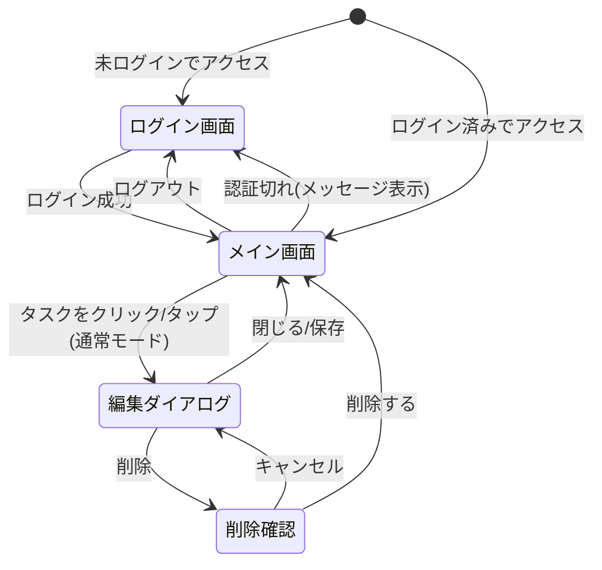

# 画面遷移図

最終更新: 2026-11-17 / 状態: **確定(コード実装は未着手)**

ラベル: 【確定】=承認済み / 【提案】=承認待ち / 【未決定】=要検討。内容は分割前の要件定義書・画面設計書から移したもので、仕様は変えていない。

## 2. 画面遷移

### 2.1 認証切れ時の動き

- 【確定】認証切れ(ログイン状態の期限切れ)を検知したら、ログイン画面へ移動する
- 【確定】ログイン画面に「ログインの有効期限が切れました」などのメッセージを表示する(文言は UC-09 で確定)
- 【確定】再ログインに成功したら、メイン画面へ戻す
- 【確定】認証切れによって保存できなかった操作は、自動的に再実行しない
- 【確定】入力途中の未保存内容は、失われることを許容する
- 【確定】入力内容の一時保持や、中断した操作の再開機能は、今回は対象外とする

### 2.2 遷移図

すべて【確定】。

### 2.3 遷移の一覧

| 遷移元 | きっかけ | 遷移先 | ラベル |
| --- | --- | --- | --- |
| ログイン画面 | ログイン成功 | メイン画面 | 確定(認証切れ後の再ログインはメイン画面へ戻す) |
| メイン画面 | 認証切れを検知 | ログイン画面(メッセージ表示) | 確定 |
| メイン画面 | ログアウト操作 | ログイン画面 | 確定 |
| メイン画面 | タスクのクリック/タップ(通常モード) | 編集ダイアログ | 確定 |
| 編集ダイアログ | 削除 | 削除確認ダイアログ | 確定 |
| 未ログインで開いたとき | メイン画面の URL にアクセス | ログイン画面 | 確定 |
| ログイン済みで開いたとき | ログイン画面の URL にアクセス | メイン画面 | 確定 |
| 編集ダイアログ | 閉じる/保存 | メイン画面(ダイアログが閉じる) | 確定(閉じ方・保存方式は UC-04) |
| 削除確認ダイアログ | キャンセル | 編集ダイアログ | 確定 |
| 削除確認ダイアログ | 「削除する」 | メイン画面(ダイアログが閉じる) | 確定(遷移図に含めて承認) |
| 編集ダイアログ | 変更があるまま閉じる操作 | 破棄確認ダイアログ | 確定(UC-04) |
| 破棄確認ダイアログ | 「破棄する」 | メイン画面(変更を保存せず閉じる) | 確定(UC-04) |
| 破棄確認ダイアログ | 「編集を続ける」 | 編集ダイアログ(入力内容を維持) | 確定(UC-04) |
